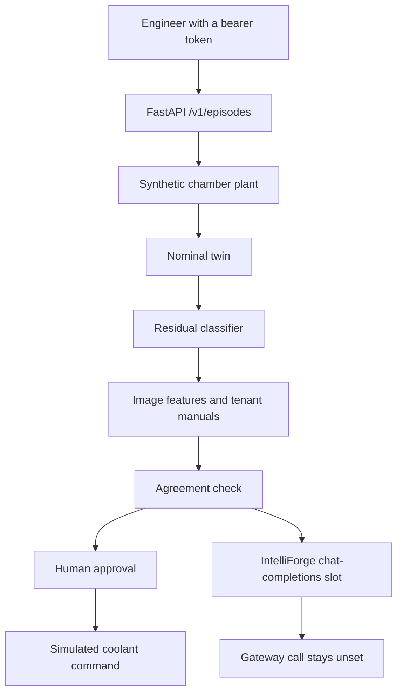
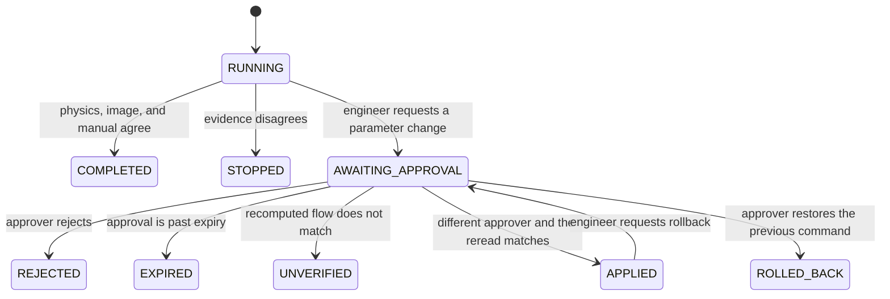

# FabTwin AI — Semiconductor Equipment Digital Twin & Intelligence Platform

Open-source digital-twin reference platform combining equipment telemetry, physics-based simulation, numerical optimization, multimodal AI diagnostics, and governed agent workflows using synthetic semiconductor manufacturing scenarios.

The equipment records are synthetic (`SYN-` identifiers, `real_equipment: 0`). The chamber model runs in-process. Kafka, PostgreSQL, Grafana, a vision-language model, and the IntelliForge model gateway are adapter slots.

**Deployment decision: NO-GO.** The workstation figures are in [benchmarks/results/benchmark_report.md](benchmarks/results/benchmark_report.md).

## Architecture

An engineer asks why synthetic chamber `SYN-CHAMBER-A` on `SYN-TOOL-01` looks hot. The API copies the tenant from the bearer token. A SciPy ODE plant supplies the observed trace, a nominal twin supplies the prediction, and the residual classifier proposes a fault. Classical features of a synthetic inspection image and a tenant-filtered manual must name that same fault before the run is `COMPLETED`. The answer states whether the setpoint was applied.



A parameter change is a separate action. It waits for a different approver in the same tenant. Approval recomputes the flow. Rollback restores the previous simulated command.



| Layer | What the demo runs | Adapter slot |
| --- | --- | --- |
| Plant | `scipy.integrate.solve_ivp`, method RK45 | A production equipment model |
| Twin | In-process residual between nominal and observed traces | Kafka ingest |
| State | In-memory command slot and audit list | PostgreSQL |
| Inspection | 16 by 16 synthetic arrays and classical features | A vision-language model |
| Public archive | NIST SEM metrics zip, cited as SPEC | U-Net inference |
| Manuals | Tenant overlap retrieval | A shared knowledge service |
| Optimization | `scipy.optimize.minimize_scalar` on the diagnosed fault map | A learned plant estimate |
| Model call | HTTP `POST /v1/chat/completions` when `INTELLIFORGE_BASE_URL` is set | [IntelliForge](https://github.com/JatinF/intelliforge-ai-platform) |
| Governance | Reader, engineer, approver, rollback | An external identity provider |
| Display | Panel names in `infrastructure/grafana/dashboard.json` | Grafana |

The longer write-up is [docs/architecture.md](docs/architecture.md). Data sources, threats, and the benchmark method are in [docs/](docs/).

## How this sits with IntelliForge

| | [IntelliForge](https://github.com/JatinF/intelliforge-ai-platform) | This repository |
| --- | --- | --- |
| Core objective | Model routing, local adaptation, and evaluation | Engineering and equipment intelligence |
| Model serving | NumPy LoRA stand-in and an open-weight slot | HTTP client of `POST /v1/chat/completions` |
| Simulation | Coolant-flow tool | Chamber ODE, residuals, and governed parameter changes |
| Manufacturing story | Synthetic maintenance cases | Synthetic chamber episodes plus a public SEM metrics archive |

The repositories stay independent. FabTwin does not vendor the LoRA trainer, the router, or the IntelliForge scorer. With `INTELLIFORGE_BASE_URL` unset, `gateway.called` stays false and the fault comes from the physics, image, and manual agreement. A live IntelliForge local head expects an IntelliForge case id such as `SYN-CASE-001` in the prompt. A FabTwin episode prompt is outside that head's contract. The benchmark records zero gateway calls.

## Evidence

| Tag | Meaning in this repo |
| --- | --- |
| `EXAMPLE` | Chamber constants, synthetic episodes, manuals, and inspection arrays |
| `SPEC` | NIST Dice means copied from `dice-coef-global.csv`, and the NIST digital-twin program description |
| `GATE` | Deployment `NO-GO`. Kafka, PostgreSQL, Grafana, live equipment, the vision-language model, U-Net inference, the IntelliForge call, and GPU are `not-run` |
| `MEASURED` | Rows in [benchmarks/results/benchmark_report.md](benchmarks/results/benchmark_report.md) |

No token price is applied. This path records 0 tokens.

## This workstation run

The figures below are copied from [benchmarks/results/benchmark_report.md](benchmarks/results/benchmark_report.md). Machine line: Windows 11 AMD64, `platform=Windows-11-10.0.26200-SP0`, `processor=Intel64 Family 6 Model 140 Stepping 1, GenuineIntel`, `cpu_count=8`, Python 3.12.10, NumPy 2.5.4, SciPy 1.18.1.

| Measurement | Value |
| --- | --- |
| Nominal recommended flow | 0.549999 |
| Nominal steady temperature | 70.000063 C |
| Cooling-fault recommended flow | 0.999995 |
| Cooling-fault steady temperature | 130.000563 C |
| Cooling bound restores 70 C | false |
| Normal-trace false positives, 30 trials, seed 7 | 0 |
| Qualification episodes passed | 4 of 4 |
| Diagnose P50, 40 calls of SYN-EP-001 | 2.777 ms |
| Diagnose P95, 40 calls of SYN-EP-001 | 5.296 ms |
| Gateway calls | 0 |
| Tokens | 0 |
| Kafka, PostgreSQL, Grafana, vision-language model, U-Net, GPU | not-run |

The NIST global Dice means below are copied from `dice-coef-global.csv`. Evidence class SPEC. FabTwin did not run the U-Net. eval31 mean 0.7888469074374048, eval51 mean 0.8466672651576093, eval71 mean 0.8162391854030813. The metrics zip is 787689 bytes. Its SHA-256 is in the report.

## Run the tests

Python 3.12 or newer.

```bash
python -m pip install -e ".[dev]"
python benchmarks/run_benchmark.py
python -m pytest
uvicorn fabtwin.api.app:create_app --factory
```

`run_benchmark.py` solves the four noiseless faults, runs the 30-trace noise study, scores the qualification episodes, times 40 diagnoses, reads the NIST archive, and rewrites `benchmarks/results/`. Pytest does not open a model socket. The workflow in [`.github/workflows/ci.yml`](.github/workflows/ci.yml) installs the package on Ubuntu 24.04 and runs pytest.

Docker Compose profiles `app` and `telemetry` are in the tree. They were not started for the committed measurement. `local-demo-only` is a fixture password. The Kafka image tag was not pulled.

## API

Dev tokens are fixtures. They authorize nothing outside this process.

| Token | Tenant | Role |
| --- | --- | --- |
| `dev-reader-a` | `tenant-a` | reader |
| `dev-engineer-a` | `tenant-a` | engineer |
| `dev-approver-a` | `tenant-a` | approver |
| `dev-engineer-b` | `tenant-b` | engineer |

`GET /healthz` reports `real_equipment: 0`, `live_control: false`, and `mode: simulation-only`.

`POST /v1/episodes` accepts `episode_id` and `action`. `diagnose` is allowed for a reader, an engineer, or an approver. `apply_coolant` and `rollback` require an engineer. Extra fields are rejected. A missing or unknown bearer token returns 401. Another tenant's episode returns 404.

`POST /v1/approvals/{id}/decision` accepts `approve` or `reject`. The approver must be a different subject in the same tenant. `GET /v1/audit/{id}` returns a record only for that tenant.

`SYN-EP-001` is a low-coolant episode. The bounded recommendation does not restore 70 C. `SYN-EP-002` is a pressure leak and the action is hold. `SYN-EP-003` is sensor drift and the action is hold. `SYN-EP-005` pairs a cooling plant with a normal image and stops. `SYN-EP-B01` belongs to `tenant-b`.

## Layout

```
fabtwin-ai-digital-twin/
├── README.md
├── pyproject.toml
├── Dockerfile
├── docker-compose.yml
├── src/fabtwin/
│   ├── api/
│   ├── diagnostics/
│   ├── evaluation/
│   ├── gateway_client/
│   ├── governance/
│   ├── simulation/
│   └── twin/
├── benchmarks/
│   ├── run_benchmark.py
│   └── results/
├── datasets/
│   ├── synthetic_equipment/
│   └── public_nist/
├── tests/
├── infrastructure/
└── docs/
    ├── architecture.md
    ├── data-sources.md
    ├── threat-model.md
    └── benchmark-methodology.md
```

`src/fabtwin/paths.py` resolves the dataset directories from the repository root. Install the package in editable mode from that root.
