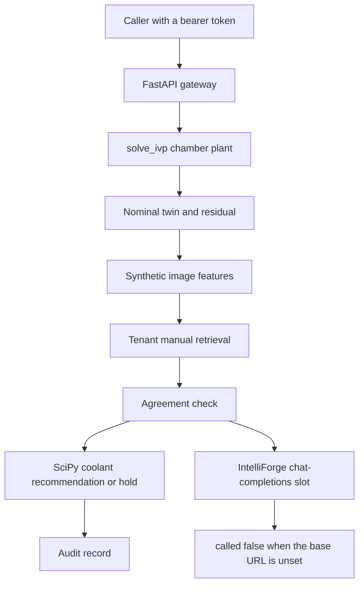

# Architecture

FabTwin is a simulation-only reference for a semiconductor equipment digital twin. The path that runs here keeps a lumped chamber model, an in-process telemetry boundary, classical inspection features, tenant-filtered manuals, and a human approval gate. Synthetic episode identifiers start with `SYN-`. `real_equipment` is 0. `live_control` is false.

**Deployment decision: NO-GO.** Kafka, PostgreSQL, Grafana, a vision-language model, U-Net inference, a GPU, and a call to the IntelliForge gateway were not executed.

## What runs locally

| Piece | Where it lives | What this repository does with it |
| --- | --- | --- |
| Plant | `src/fabtwin/simulation/plant.py` | State `[T, P]`. RK45, `rtol=1e-6`, `atol=1e-8`, horizon 40 s |
| Optimizer | `src/fabtwin/simulation/optimize.py` | Bounded scalar search on the diagnosed fault's EXAMPLE map |
| Ingest | `src/fabtwin/twin/ingest.py` | Copies a reading batch in-process |
| Residuals | `src/fabtwin/twin/residuals.py` | Compares the observed plant with the nominal twin |
| Images | `src/fabtwin/diagnostics/images.py` | Renders and classifies four synthetic 16 by 16 arrays |
| Manuals | `src/fabtwin/diagnostics/manuals.py` | Filters by tenant, then ranks token overlap |
| NIST archive | `src/fabtwin/diagnostics/nist_archive.py` | Reads the committed metrics zip. Dice rows stay SPEC |
| Gateway client | `src/fabtwin/gateway_client/client.py` | `POST /v1/chat/completions` on `INTELLIFORGE_BASE_URL` |
| Governance | `src/fabtwin/governance/auth.py` | Fixture tokens, role checks, in-memory audits |
| Workflow | `src/fabtwin/workflow.py` | Agreement, approval, reread, and rollback |
| API | `src/fabtwin/api/app.py` | `/healthz`, episodes, approvals, audit reads |
| Score | `src/fabtwin/evaluation/score.py` | Qualification check for synthetic episodes |

## Plant

The constants are EXAMPLE values chosen so a nominal coolant fraction of 0.55 has a steady temperature of 70 C when the coolant scale is 1. They are not a production tool model.

`dT/dt = (q_heat - u_actual * h * (T - T_coolant)) / c_thermal`

`dP/dt = (p_supply - P) / tau_p - leak * P`

`u_actual = command_flow * coolant_scale`

Injected faults:

| Fault | Change | What the residual shows on the noiseless qualification trace |
| --- | --- | --- |
| `normal` | Scale 1, leak 0, drift 0 | Temperature and pressure residuals stay inside the normal band |
| `cooling_flow_low` | `coolant_scale` 0.25 | Temperature residual rises while pressure stays with the twin |
| `pressure_leak` | `leak` 0.4 | Pressure residual falls while temperature stays with the twin |
| `sensor_drift` | Observation `T + 0.5 * t` | Temperature residual climbs with a positive slope. The plant physics stays nominal |

The classifier bands live in `classify_residual`. The benchmark report records the residuals from the workstation run.

## Optimization

`recommend_flow` minimizes `(steady_temperature(flow) - 70)^2 + 0.01 * flow^2` on the closed interval [0.2, 1.0]. `steady_temperature` uses the EXAMPLE parameters of the diagnosed fault, including that fault's coolant scale. It is not a learned estimate.

For `cooling_flow_low` the steady map at the upper bound stays above 100 C. The recommendation sets `restores_target` false and the answer contains `The coolant bound does not restore 70 C.` A pressure leak and sensor drift return action `hold`. `apply_coolant` on those episodes returns HTTP 400 with `coolant apply is not the recommendation`.

## Evidence agreement

Completion requires the physics label, the image label, and the top manual's fault class to be the same known label. The evidence ids are then the manual id and the image id. Otherwise the status is `STOPPED`, `completion_claimed` is false, `fault_class` is null, and the evidence list is empty. The answer contains `The setpoint was not applied.`

`SYN-EP-005` injects `cooling_flow_low` and attaches `SYN-IMG-NORMAL`. That episode stops.

The NIST archive is cited on the record. Its Dice means do not choose the fault label. `vision_language_model` is `not-run`. `unet_executed_by_fabtwin` is false.

## Governance

| Token | Tenant | Role | Subject |
| --- | --- | --- | --- |
| `dev-reader-a` | `tenant-a` | reader | `reader-a` |
| `dev-engineer-a` | `tenant-a` | engineer | `engineer-a` |
| `dev-approver-a` | `tenant-a` | approver | `approver-a` |
| `dev-engineer-b` | `tenant-b` | engineer | `engineer-b` |

Diagnose is allowed for reader, engineer, and approver. A mutating action is allowed for an engineer and returns `AWAITING_APPROVAL`. The approver must be the same tenant, role `approver`, and a different subject. Expiry is the request time plus 3600 seconds. Reject leaves the command unchanged. Approve recomputes `recommend_flow` for `cooling_flow_low` and compares within `1e-6`. A mismatch is `UNVERIFIED` and does not change the command. A match stores the previous command, writes the new fraction, and sets `APPLIED`. Rollback restores that previous command, clears `applied`, and sets `ROLLED_BACK`.

After a cooling apply, the plant scale is still 0.25, so a later residual can remain large. The audit records the command change and the rollback. It does not claim the fault disappeared.

## IntelliForge client

The default model id sent on the wire is `numpy-lora-r2-seed7`. The body is `{"model", "messages": [{"role": "user", "content"}], "stream": false}`. A bearer token is added when `INTELLIFORGE_TOKEN` or the explicit token argument is non-empty. Timeout is 30 seconds. The response body is not parsed into a fault. The physics diagnosis stands on its own.

Unset `INTELLIFORGE_BASE_URL` yields `called: false` and reason `INTELLIFORGE_BASE_URL is unset`.

`INTELLIFORGE_CASE_ID` appends that IntelliForge case id to the prompt. The gateway then runs its own case. FabTwin keeps `uses_upstream_fault` false and does not copy `upstream_fault_class` into the chamber fault. The measured localhost call is `benchmarks/results/gateway_workflow.json`.

## Adapter slots that were not executed

| Slot | Intended system | Gate |
| --- | --- | --- |
| Telemetry bus | Kafka. The in-process function is the consumer boundary | `kafka` not-run |
| System of record | PostgreSQL 16 | `postgres` not-run |
| Dashboard | Grafana, dashboard file only | `grafana` not-run |
| Equipment | Live tool I/O | `live-equipment` not-run |
| Inspection model | Vision-language model | `vision-language-model` not-run |
| SEM segmentation | NIST U-Net weights | `unet-inference` not-run |
| Model platform | IntelliForge `POST /v1/chat/completions` | `intelliforge-gateway-call` not-run |
| Accelerator | GPU | `gpu` not-run |

`docker-compose.yml` defines the API, PostgreSQL, Kafka, and Grafana behind profiles. None of those services were started for the committed benchmark. Image tags in that file were not pulled on the workstation. The fixture password is `local-demo-only`.

## Companion

[IntelliForge](https://github.com/JatinF/intelliforge-ai-platform) at commit `fe13478` is the model gateway this client is shaped to call. This repository does not copy its trainer, router, or evaluator.
